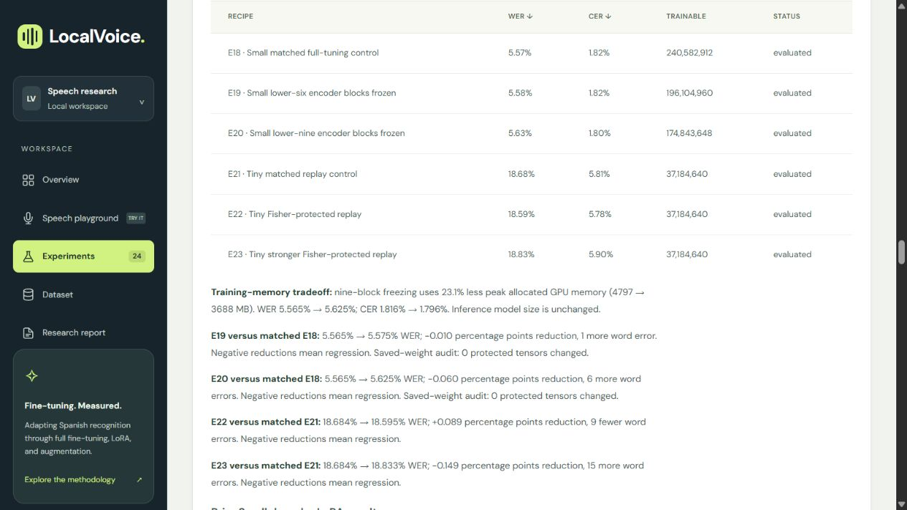

# LocalVoice

**A local Spanish speech-recognition workbench for fine-tuning Whisper, comparing checkpoints, and measuring accuracy–memory tradeoffs.**

LocalVoice pairs a Python/CUDA experiment pipeline with a responsive web dashboard and speech playground. It studies adaptation with limited labeled speech data; Spanish itself is not presented as a low-resource language.



[Results](#measured-results) · [Quickstart](#quickstart) · [Training](#training-and-reproducibility) · [Verification](#verification) · [Limitations](#limitations)

## What it does

- Fine-tunes the existing Whisper Tiny and Small backbones using full/decoder tuning, LoRA, augmentation, partial encoder freezing, and Fisher EWC.
- Tracks optimizer updates, training loss, validation curves, trainable parameters, GPU allocation, and checkpoint selection.
- Compares a trained checkpoint with its own pretrained baseline on the same uploaded, recorded, or dataset-sample audio.
- Reports word error rate (WER), character error rate (CER), substitutions, deletions, and insertions.
- Preserves run histories, configuration and checkpoint hashes, failed recipes, and measured before/after comparisons.

## Measured results

### Pretrained vs. fine-tuned

Both comparisons use the **same 407 FLEURS Spanish validation clips**. Each tuned checkpoint is paired with its own pretrained backbone.

| Metric | Whisper Tiny | Whisper Small |
| :--- | ---: | ---: |
| Runs | `E0` → `E11` | `E7` → `E18` |
| Pretrained WER | 20.79% | 6.34% |
| **Fine-tuned WER** | **18.40%** | **5.57%** |
| **Relative WER reduction** | **11.5%** | **12.2%** |
| CER, before → after | 6.50% → 5.80% | 2.16% → 1.82% |
| Word errors, before → after | 2,092 → 1,851 | 638 → 560 |
| **Fewer word errors** | **241** | **78** |

Word error rate (WER) counts substitutions, deletions, and insertions per 100 reference words. Character error rate (CER) counts edits at the character level. Lower is better for both. Measurements used an NVIDIA RTX 4060 Laptop GPU with 8 GB VRAM, Python 3.13, and CUDA PyTorch.

### What the fine-tuning changed

- **Tiny improved by 2.40 percentage points of WER.** The gain came mainly from replacing fewer words incorrectly (164 fewer substitutions) and adding fewer words (72 fewer insertions). Omissions changed little (5 fewer deletions). E11 combined a higher learning rate, a smaller effective batch, and light time masking. Those settings changed together, so the experiment measures the combined recipe.
- **Small improved by 0.78 percentage points of WER.** Decoder tuning alone cut the error count by **67**. Adapting the encoder and decoder cut it by another 11, and the final run beat the previous best full-tuning run by four errors. Most of Small’s measured gain came from the decoder stage.
- **Some recipes traded one error type for another.** Tiny's teacher-regularized recipe E12 made 49 fewer deletions than E11 but added 177 insertions and 183 substitutions. Its WER rose from 18.40% to 21.49%, above the 20.79% pretrained baseline. Small's decoder LoRA run E16 used about 67% less peak allocated training GPU memory than E10, with higher validation WER (5.84% versus 5.61%).

E11 and E18 were selected using FLEURS validation scores from single-seed training runs. An earlier Small checkpoint, E8, also improved from 6.34% to 5.62% WER on the original 907-clip FLEURS test. Fresh held-out FLEURS performance for E11 and E18 remains unmeasured. [Full experiment measurements](docs/RESULTS.md).

### Results on other Spanish recordings

| Evaluation | Compared checkpoints | WER | CER |
| --- | --- | --- | --- |
| Latin American Spanish holdout (300 clips) | Tiny pretrained E0 → replay-tuned E17 | 24.42% → **19.80%** | 9.13% → **7.11%** |
| Spanish audiobook dev sample (300 clips, exploratory) | Tiny pretrained E0 → audiobook-adapted E13 | 23.93% → **20.27%** | 7.54% → **6.47%** |

**The best Tiny checkpoint depended on the recordings.** FLEURS-tuned E11 scored 24.97% WER on the Latin American holdout, worse than pretrained Tiny at 24.42%. E17 continued from E11 with 3,000 Argentinian Spanish recordings mixed with the original FLEURS training data. It removed 151 holdout word errors relative to E11 and cut WER by **18.9% relative** to pretrained Tiny, while adding 25 word errors on FLEURS validation relative to E11. The holdout was reserved before E17 training and checked for transcript overlap. Speaker independence is unknown because the source lacks speaker IDs.

The audiobook result shows a similar tradeoff. Adding Spanish audiobook training data in E13 reduced WER by **15.3% relative** to pretrained Tiny on the exploratory audiobook sample. On FLEURS validation, E13 reached 18.91% WER, behind E11 at 18.40%. [Domain-specific comparisons and evaluation details](docs/FINE_TUNING_COMPARISON.md) · [Published evidence](docs/evidence/README.md).

<!-- RESEARCH_RESULTS_START -->
## Latest research-method results

The controlled E18–E23 round tested partial encoder freezing and Fisher-weighted elastic weight consolidation (EWC) on the existing backbones.

**Partial freezing:** nine frozen lower blocks reduce peak allocated training memory 4,797 → 3,688 MB (**23.1% lower**). CER improves 1.8160% → 1.7957%, while WER worsens 5.5655% → 5.6251%. Inference size is unchanged; this is a training-resource tradeoff.

**Fisher EWC:** 18.6842% → 18.5947% WER versus matched replay (9 fewer word errors), but it does not beat retained Tiny E11. The stronger penalty regresses. These are single-seed development comparisons; no fresh blind test is claimed.

**Retained checkpoints:** Small **E18** (5.5655% WER), Tiny **E11** (18.3959% WER). The Small choice removes 4 word errors versus previous E10. The newer methods did not produce a new Tiny WER record.

[Controlled comparisons, exact error counts and limitations](docs/RESEARCH_METHOD_RESULTS.md) · [Implementation and paper references](docs/RESEARCH_METHODS_IMPLEMENTATION.md) · [Workbench preview](docs/research-method-results-20261101.png).

<!-- RESEARCH_RESULTS_END -->

## Quickstart

Use Python **3.11–3.13**. Run these commands from your cloned repository.

**Windows / PowerShell**

```powershell
py -3.13 -m venv .venv
.venv\Scripts\python.exe -m pip install --upgrade pip
.venv\Scripts\python.exe -m pip install -e '.[dev]'
.venv\Scripts\python.exe -m localvoice.cli serve
```

**Linux / macOS**

```bash
python3 -m venv .venv
source .venv/bin/activate
python -m pip install --upgrade pip
python -m pip install -e '.[dev]'
python -m localvoice.cli serve
```

Open **[http://127.0.0.1:8000](http://127.0.0.1:8000)**. The base installation runs the dashboard and CPU/API tests. For transcription and training, install the `ml` extra (`python -m pip install -e '.[ml,dev]'`) and a PyTorch build appropriate for your hardware. The measured training environment is recorded in [requirements-lock.txt](requirements-lock.txt); that Windows/CUDA snapshot is not a universal installation lock.

**Fresh-clone behavior:** downloaded data, model weights, and local checkpoints are excluded from Git. The live dashboard shows runs as planned until you prepare data and train/evaluate locally. Published results and screenshots remain available in the documentation; they are not preloaded checkpoints.

## Try speech recognition

With the ML dependencies and a checkpoint available, open **Speech playground** and upload or record up to **30 seconds** of Spanish audio. Select a checkpoint, optionally enable its pretrained-baseline comparison, and provide a reference transcript to calculate clip-level WER/CER.

The dataset-sample button uses a **training clip** for functional testing; its score is not independent evaluation evidence. Training reserves the GPU, and transcription resumes when the experiment series finishes. The API processes audio locally without saving uploads. Downloads require internet; optional Google Fonts load externally.

## Training and reproducibility

Prepare and validate the original Spanish FLEURS corpus:

```powershell
.venv\Scripts\python.exe -m localvoice.cli prepare
.venv\Scripts\python.exe -m localvoice.cli validate
.venv\Scripts\python.exe -m localvoice.cli evaluate E0
```

The historical four-strategy comparison can be run with `python -m localvoice.cli matrix`. **E1–E6 used a superseded training-prompt setup**; their measured outcomes are retained for transparency, and the [prefix correction](docs/TRAINING_PREFIX_FIX.md) explains the defect. Use the corrected later recipes when studying current fine-tuning behavior.

Run IDs identify recipes and saved checkpoints, not additional backbone architectures. Configurations and source revisions are pinned in `configs/`. Warm-start recipes require their recorded parent checkpoints; the research round is not a one-command fresh-clone training shortcut.

| Experiment track | Reproduction notes |
| --- | --- |
| Corrected Tiny/Small adaptation | [Accuracy track and prerequisites](docs/ACCURACY_TRACK.md) |
| Decoder/encoder acoustic adaptation | [Acoustic adaptation](docs/ACOUSTIC_ADAPTATION.md) |
| Additional Spanish audiobook training | [Data preparation and protocol](docs/DIVERSE_DATA_TUNING.md) |
| Latin American replay | [Partition, license, and method](docs/LATIN_REPLAY_ROUND.md) |
| Decoder LoRA | [Regularized LoRA recipe](docs/REGULARIZED_LORA_ROUND.md) |
| Partial freezing and EWC | [Controlled methods and execution](docs/RESEARCH_METHODS_IMPLEMENTATION.md) |

The latest controlled round uses `python -m localvoice.research_round` once the documented parents and datasets exist; `python -m localvoice.ewc_followup` runs the separately recorded stronger-penalty follow-up after that round. Completed artifacts are preserved, and repeating a run in the same directory is refused.

Raw histories, predictions, training provenance, and checkpoint files are stored locally in `runs/`. Derived public exports use project-relative paths; historical fingerprints retain their original values. [Evidence-export notes](docs/evidence/README.md) explain why fingerprints can differ across checkout locations.

## Verification

```powershell
.venv\Scripts\python.exe -m pytest -q
node --check frontend/app.js
.venv\Scripts\python.exe -m compileall -q localvoice scripts
```

The publication review passed **39 tests** in the full local environment. A clean source copy without downloaded assets passed **36 tests**, with **three optional-asset tests skipped**. JavaScript syntax checks and live CUDA playground requests also passed. See [verification notes](docs/VERIFICATION.md) for coverage and limits. ML tests skip when optional dependencies/assets are unavailable; GPU training is not part of the unit-test suite.

## Limitations

- Main accuracy comparisons are validation findings from one training seed. Fresh held-out confirmation and repeated-seed evaluation remain outstanding.
- Previously inspected FLEURS/MLS tests are labeled as reused diagnostics. Corpus-specific improvements are not combined into one score or claimed to generalize to every Spanish recording.
- Speaker IDs are missing in some prepared corpora; text-disjoint clips do not establish unseen-speaker performance. Whisper pretraining overlap with public datasets is unknown.
- Training-only augmentation, verified Spanish/task prefixes, fixed normalization, pinned models, and matched decoding controls support fair comparisons. More aggressive tuning, additional data, or stronger penalties can regress.
- Peak allocated training memory is distinct from total device usage. Single-run latency measurements do not establish a reliable speed improvement.

## Project layout

```text
configs/        Experiment recipes and pinned project/model settings
localvoice/     Preparation, training, evaluation, inference, and FastAPI server
frontend/       Dashboard, speech playground, and brand board
scripts/        Report generation and local utility commands
tests/          CPU/API contracts and optional ML regression checks
docs/           Methods, results, screenshots, reviews, and evidence exports
data/           Local downloads and prepared audio (ignored by Git)
runs/           Local checkpoints and raw experiment artifacts (ignored by Git)
```

The frontend uses a responsive bento layout, keyboard-accessible controls, and reduced-motion handling. [Interface and accessibility reviews](docs/reviews/README.md) document measured checks and their limits. The [brand board](frontend/brand-board.html) can be viewed through `/assets/brand-board.html` on the running server.

## Data and attribution

Primary sources: [Google FLEURS](https://huggingface.co/datasets/google/fleurs) (CC-BY-4.0), [OpenAI Whisper](https://github.com/openai/whisper) (Apache-2.0), [Spanish MLS / OpenSLR 94](https://www.openslr.org/94/) (CC-BY-4.0), and [Argentinian Spanish / OpenSLR 61](https://www.openslr.org/61/) (CC-BY-SA-4.0). Models and datasets retain their own terms. See [third-party notices](THIRD_PARTY_NOTICES.md) and the [research references](docs/RESEARCH_FINE_TUNING_NEXT_STEPS.md).

## All experiment measurements

<details>
<summary>Expand the complete measured experiment series and historical diagnostics</summary>

<!-- MEASURED_RESULTS_START -->
## Measured Spanish results

Validation findings are provisional. Held-out test evaluation remains separate. Negative reductions are regressions; missing runs are pending.

| Run | WER | CER | WER reduction vs matched baseline | Trainable weights | Training time |
| --- | --- | --- | --- | --- | --- |
| E0 · Pretrained baseline | 20.79% | 6.50% | — | 0 | 0.0 min |
| E1 · Full fine-tuning | 20.91% | 6.71% | -0.12 pp vs E0 | 37,184,640 | 8.5 min |
| E2 · LoRA fine-tuning | 21.57% | 6.90% | -0.78 pp vs E0 | 147,456 | 20.0 min |
| E3 · Full + augmentation | 20.48% | 6.55% | +0.31 pp vs E0 | 37,184,640 | 14.4 min |
| E4 · LoRA + augmentation | 23.26% | 7.62% | -2.46 pp vs E0 | 147,456 | 29.5 min |
| E5 · Conservative full tuning | 19.48% | 6.06% | +1.31 pp vs E0 | 37,184,640 | 15.2 min |
| E6 · Stable LoRA tuning | 20.88% | 6.79% | -0.09 pp vs E0 | 294,912 | 11.9 min |
| E7 · Whisper Small pretrained | 6.34% | 2.16% | — | 0 | 0.0 min |
| E8 · Whisper Small decoder tuning | 5.67% | 1.83% | +0.67 pp vs E7 | 153,580,800 | 29.0 min |
| E9 · Prompt-aligned Tiny tuning | 19.25% | 5.87% | +1.54 pp vs E0 | 37,184,640 | 17.9 min |
| E10 · Small encoder + decoder adaptation | 5.61% | 1.83% | +0.74 pp vs E7 | 240,582,912 | 59.9 min |
| E11 · Tiny stronger acoustic adaptation | 18.40% | 5.80% | +2.40 pp vs E0 | 37,184,640 | 27.0 min |
| E12 · Tiny teacher-regularized fine-tuning | 21.49% | 6.53% | -0.70 pp vs E0 | 37,184,640 | 28.7 min |
| E13 · Tiny diverse-data fine-tuning | 18.91% | 5.86% | +1.88 pp vs E0 | 37,184,640 | 32.7 min |
| E14 · Tiny final domain refinement | 18.96% | 5.84% | +1.83 pp vs E0 | 37,184,640 | 40.8 min |
| E15 · Small higher-rate decoder refinement | 5.83% | 1.95% | +0.51 pp vs E7 | 153,580,800 | 39.7 min |
| E16 · Small regularized decoder LoRA | 5.84% | 1.92% | +0.50 pp vs E7 | 589,824 | 25.9 min |
| E17 · Tiny Latin American replay tuning | 18.64% | 5.80% | +2.15 pp vs E0 | 37,184,640 | 32.1 min |
| E18 · Small matched full-tuning control | 5.57% | 1.82% | +0.78 pp vs E7 | 240,582,912 | 60.2 min |
| E19 · Small lower-six encoder blocks frozen | 5.58% | 1.82% | +0.77 pp vs E7 | 196,104,960 | 66.6 min |
| E20 · Small lower-nine encoder blocks frozen | 5.63% | 1.80% | +0.72 pp vs E7 | 174,843,648 | 53.5 min |
| E21 · Tiny matched replay control | 18.68% | 5.81% | +2.11 pp vs E0 | 37,184,640 | 33.4 min |
| E22 · Tiny Fisher-protected replay | 18.59% | 5.78% | +2.20 pp vs E0 | 37,184,640 | 34.4 min |
| E23 · Tiny stronger Fisher-protected replay | 18.83% | 5.90% | +1.96 pp vs E0 | 37,184,640 | 36.6 min |

Base model: `openai/whisper-tiny`. Language: Spanish. Baseline evaluation: 407 clips, `validation` split. Each comparison also requires the same dataset fingerprint and normalization.

Lowest measured Tiny tuned WER: **E11 · 18.40%**. Versus E0: **+2.40 percentage points** WER reduction (**+11.52% relative**), and **+0.70 points** CER reduction.

E5/E6 are follow-up recipe experiments, not replacements for E1–E4. They use lower learning rates, effective batch 32, restored training punctuation/casing, and weight decay 0.05. See `docs/FINE_TUNING_IMPROVEMENTS.md` for exact settings. Several settings changed together; gains cannot be attributed to one change alone.

E1–E6 preserve measurements from a superseded tokenizer-prompt setup. The fast tokenizer omitted Spanish/task tokens from training labels; E9 explicitly aligns and verifies them. See `docs/TRAINING_PREFIX_FIX.md`. The original pretrained generation baselines are unaffected.

### Whisper Small accuracy track

E7 is the original Whisper Small checkpoint; E8 tunes its decoder while freezing its audio encoder. E10 also adapts the encoder. E8 versus E7 measures fine-tuning. Small versus Tiny also changes the base model and is not a pure tuning gain. Small runs use batch-four float32 greedy evaluation, with amortized generation time per clip. Tiny timings use single-clip generation.

**E8 fine-tuning gain versus E7: +0.67 pp WER (+10.50% relative)**. CER reduction: +0.33 pp.

**E10 fine-tuning gain versus E7: +0.74 pp WER (+11.60% relative)**. CER reduction: +0.33 pp.

**E15 fine-tuning gain versus E7: +0.51 pp WER (+7.99% relative)**. CER reduction: +0.21 pp.

**E16 fine-tuning gain versus E7: +0.50 pp WER (+7.84% relative)**. CER reduction: +0.24 pp.

**E18 fine-tuning gain versus E7: +0.78 pp WER (+12.23% relative)**. CER reduction: +0.34 pp.

**E19 fine-tuning gain versus E7: +0.77 pp WER (+12.07% relative)**. CER reduction: +0.34 pp.

**E20 fine-tuning gain versus E7: +0.72 pp WER (+11.29% relative)**. CER reduction: +0.36 pp.

### Original FLEURS test after the earlier frozen selection

These checkpoints were chosen using validation scores before the original test evaluation. That test has already been reported and is not fresh evidence for the later E10/E11 development round.

| Run | Test WER | Test CER | Test clips |
| --- | --- | --- | --- |
| E0 · Pretrained baseline | 19.11% | 6.10% | 907 |
| E5 · Conservative full tuning | 18.16% | 5.96% | 907 |
| E7 · Whisper Small pretrained | 6.34% | 2.16% | 907 |
| E8 · Whisper Small decoder tuning | 5.62% | 1.80% | 907 |
| E9 · Prompt-aligned Tiny tuning | 17.93% | 5.51% | 907 |
| E10 · Small encoder + decoder adaptation | 5.65% | 1.81% | 907 |

E5 held-out WER reduction versus E0: **+0.95 pp (+4.97% relative)**.

E8 held-out WER reduction versus E7: **+0.73 pp (+11.46% relative)**.

E9 held-out WER reduction versus E0: **+1.18 pp (+6.17% relative)**.

E10 held-out WER reduction versus E7: **+0.70 pp (+10.98% relative)**.

### Spanish MLS: historical test and reused diagnostic

Fixed 300-clip sample from 20 speakers; 1.276 hours. Selection is frozen in `runs/selection-acoustic.json` using FLEURS validation only. All models use the same batch-four float32 greedy decoding. MLS is a separate audiobook domain. These scores belong to the frozen E10/E11 round; later recipes are exploratory and do not inherit this holdout's independence. Pretraining overlap is unknown.

| Run | MLS WER | MLS CER | Clips |
| --- | --- | --- | --- |
| E0 · Pretrained baseline | 22.13% | 7.12% | 300 |
| E7 · Whisper Small pretrained | 8.16% | 3.18% | 300 |
| E8 · Whisper Small decoder tuning | 9.49% | 3.40% | 300 |
| E9 · Prompt-aligned Tiny tuning | 23.31% | 7.44% | 300 |
| E10 · Small encoder + decoder adaptation | 9.63% | 3.42% | 300 |
| E11 · Tiny stronger acoustic adaptation | 25.68% | 8.38% | 300 |
| E16 · Small regularized decoder LoRA | 7.89% | 2.55% | 300 |

E8 MLS WER reduction versus E7: **-1.33 pp (-16.24% relative)**.

E9 MLS WER reduction versus E0: **-1.18 pp (-5.31% relative)**.

E10 MLS WER reduction versus E7: **-1.47 pp (-17.96% relative)**.

E11 MLS WER reduction versus E0: **-3.55 pp (-16.02% relative)**.

E16 MLS WER reduction versus E7: **+0.27 pp (+3.33% relative)**.

### New-clip MLS dev follow-up (exploratory)

A fixed seed-43 sample of 300 previously unused dev clips. The earlier MLS test was already read before this data-focused round, so this is an exploratory follow-up, not a fully blind study. The listed checkpoints were frozen before these scores; later rounds are reported separately. All Tiny checkpoints use the same batch-four float32 greedy decoding.

| Run | MLS dev WER | MLS dev CER | Clips |
| --- | --- | --- | --- |
| E0 · Pretrained baseline | 23.93% | 7.54% | 300 |
| E11 · Tiny stronger acoustic adaptation | 27.32% | 9.24% | 300 |
| E13 · Tiny diverse-data fine-tuning | 20.27% | 6.47% | 300 |
| E14 · Tiny final domain refinement | 20.36% | 6.50% | 300 |

E11 MLS dev WER reduction versus E0: **-3.39 pp (-14.15% relative)**.


E13 MLS dev WER reduction versus E0: **+3.66 pp (+15.29% relative)**.


E14 MLS dev WER reduction versus E0: **+3.57 pp (+14.94% relative)**.


### Latin American text-disjoint holdout

300 locally untrained recordings reserved before E17 training; no exact transcript overlap with FLEURS or added training. Speaker IDs are unavailable; pretraining overlap is unknown.

| Tiny checkpoint | WER | CER | Clips |
| --- | --- | --- | --- |
| E0 · Pretrained baseline | 24.42% | 9.13% | 300 |
| E11 · Tiny stronger acoustic adaptation | 24.97% | 9.36% | 300 |
| E17 · Tiny Latin American replay tuning | 19.80% | 7.11% | 300 |

Recipes: `docs/ACOUSTIC_ADAPTATION.md`, `docs/TEACHER_REGULARIZED_TUNING.md`, `docs/DIVERSE_DATA_TUNING.md`. Training time includes the parent stage for warm-started runs.

Exact errors, memory, latency, hyperparameters, checkpoint selection, and epoch history are available in the website and `runs/E*/` artifacts.

Generated from local artifacts at 2026-11-02T05:06:53.003163+00:00.
<!-- MEASURED_RESULTS_END -->

</details>
